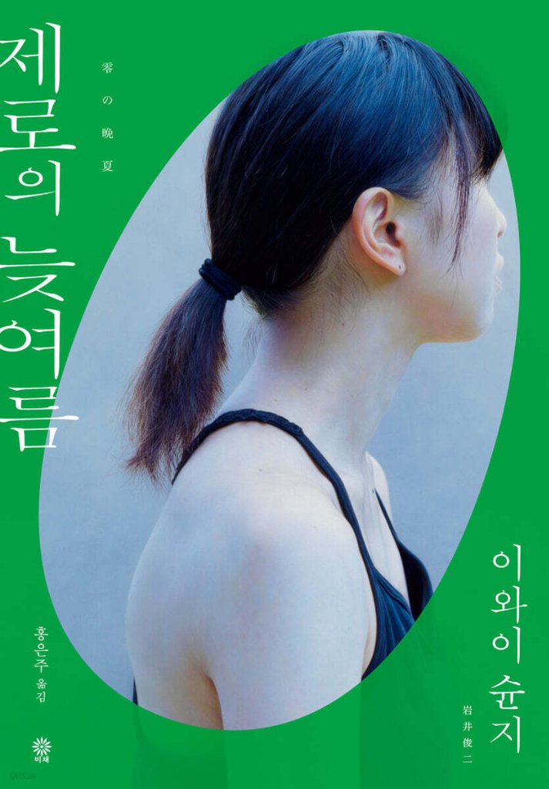

Back in high school, there was a time when I was deeply immersed in Japanese novels. Even looking back on them now as I write this, they are authors who left me with fond memories that make me want to revisit their works. Among them, the writer who stands out most in my memory is Shunji Iwai. To many in Korea, his name is best remembered as the director of *Love Letter*, a massive hit in the 1990s. For me, I actually encountered *Love Letter* as a book before seeing the film, and I still remember closing the book on its final page in tears. Having thoroughly enjoyed the movie adaptation afterward as well, I came across a piece introducing him somewhere that mentioned his remarkable talent not only in filmmaking, but also in writing—so much so that he published his screenplays as novels. Around that time, I think I read every single book of his I could get my hands on at the library.

Many years later, *Zero's Late Summer*, published in 2024, was captivating enough to bring all those past emotions rushing back. I can only describe his ability to conceive such a story and bring it to life so engagingly as truly extraordinary. As you read a book, a writer's distinct voice and atmosphere naturally come through along with the text. Shunji Iwai's prose—even in translation—is never overly heavy; even when depicting inner psychology, it remains restrained and understated, yet weaves the story in a style that conveys those feelings effortlessly to the reader. It feels as though a kindhearted friend is sitting right beside you, telling you a fascinating anecdote. Even though it had been nearly twenty years since I last encountered his work, experiencing that exact same feeling from the very first time made the entire read deeply welcoming and thrilling.

After finishing it, I noticed that while the motif had shifted slightly, the overarching plot felt somewhat reminiscent of *Love Letter*, briefly making me wonder if this might be a 2020 version of *Love Letter*. In any case, I had feared I wouldn't be able to touch another book for a while after recklessly buying all three volumes of *Foucault's Pendulum* and diving into it, so reading something like this every now and then like a sweet treat seems like a great way to keep from burning out. I truly hope this gets made into a movie as well.
