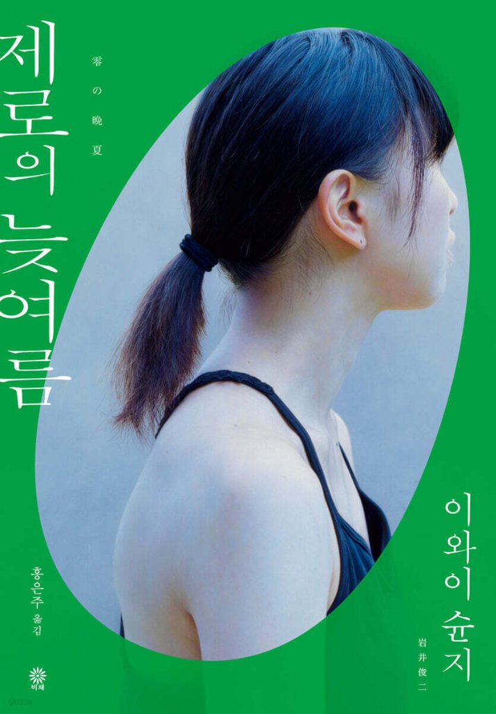

고등학교 시절, 한창 일본 작가의 소설에 빠져 있던 때가 있었다. 글을 쓰고 있는 지금 떠올려 봐도 대체로 다시 읽어 보고 싶어지는 기분 좋은 추억들을 만들어 준 작가들이다. 그중에서도 기억에 남는 작가를 꼽으라면 이와이 슌지. 많은 한국 사람들에게는 특히 90년대 대히트를 친 《러브레터》의 감독으로 기억되는 이름이다. 난 그 《러브레터》도 영화보다 책을 먼저 접했는데, 마지막 장에서 눈물을 쏟으며 책을 덮었던 기억이 있다. 이후 영화도 너무 재미있게 봤던 나는 어디선가 그를 소개하는 글에서 그가 영화뿐 아니라 글재주도 뛰어나서 시나리오를 소설로 출판한다는 사실을 알게 되었고, 그 당시 도서관에서 구할 수 있는 모든 책을 다 읽었던 것 같다.

오랜 시간이 흘러 2024년도에 출판된 《제로의 늦여름》은 그때의 그 감정을 다시 느끼게 해 줄 만큼 재미있게 봤다. 어떻게 이런 이야기를 구상하고 재미있게 적어 내는지 정말 대단한 능력이라고밖에 표현을 못 하겠다. 책을 읽다 보면 글에서 느껴지는 작가들만의 화법과 분위기가 함께 읽히기 마련인데, 이와이 슌지의 글은(비록 번역본이지만) 무겁지 않고 심리를 묘사하는 부분에 있어서도 담백하지만 독자에게 그 마음이 잘 전달될 수 있는 문체로 이야기를 풀어나간다. 마음씨 좋은 친구가 옆에 앉아서 아주 흥미로운 에피소드를 들려주는 기분. 근 20년 만에 다시 마주한 그의 작품임에도 처음 만났던 그 감정이 느껴져서 읽는 내내 반가웠고 설렜다.

다 읽고 보니 소재가 약간 바뀌었지만 전체적인 플롯은 《러브레터》와 비슷하기도 해서 2020년판 《러브레터》인가 하는 생각을 잠시 해 보기도. 아무튼 겁 없이 3권을 사 놓고 시작한 《푸코의 진자》 때문에 당분간 다른 책을 못 보겠다 싶었는데, 가끔 이렇게 간식처럼 읽는 것도 지치지 않는 좋은 방법일 것 같다. 영화로도 꼭 나왔으면 좋겠다.
