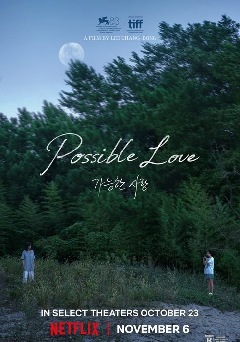

It feels as though addressing the struggles of working people is no longer confined to documentaries or the concerns of a vocal minority—rather, there seems to be a growing awareness that these issues are universal and closely tied to our own lives. Even viewed from that perspective, this film diverges from the so-called "working-class stories" we are used to seeing, and I appreciated how unforced and approachable its direction felt. I can't tell whether that awareness stems from my own steady interest over time, or whether it truly reflects a broader shift in the zeitgeist—but if a film like this earns acclaim and is embraced naturally by audiences, that in itself might serve as proof of the latter.

I jotted down my feelings here and there while watching, and it seems the film stirred up quite a rich, complex mix of thoughts and emotions. I've decided to keep those untidy feelings private and leave only a brief reflection here.

All of us live carrying our own inner desires, pursuing them sometimes brazenly and sometimes from behind a mask. And in certain moments, through a choice spurred on by those desires, we continually reshape ourselves. That is life—and perhaps that ever-shifting nature is the one truly universal humanity we all share.

It took me quite a long time after watching the film to gather my thoughts into writing. In the meantime, I came across the director and cast commentary on Netflix's YouTube channel, which turned out to be just as fascinating and entertaining as the film itself—even at over an hour long, I completely lost track of time watching it. And given all the buzz around the film, many critics and related channels have been covering it as well; hearing so many different perspectives, interpretations, and ideas has been a thoroughly enjoyable part of the experience, too.
