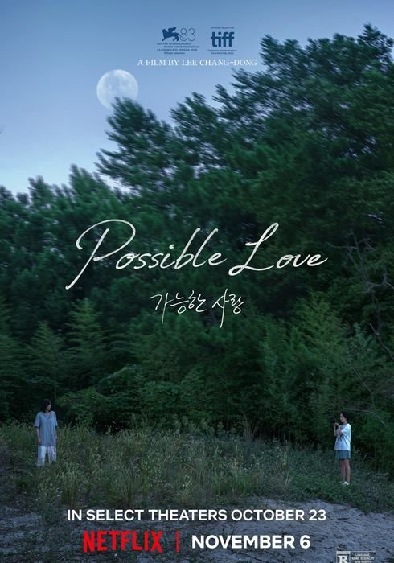

노동자들의 문제를 다루는 것이 더 이상 다큐멘터리나 소수의 문제의식에 기반한 것이 아니라, 점점 더 보편적이고 나의 삶과 맞닿아 있다는 인식이 늘어나고 있는 것 같다. 그런 인식의 기반 위에서 본다고 해도 이 영화는 우리가 흔히 접해 온 소위 '노동자 이야기'와는 맥을 달리하고 있고, 그런 거부감 없는 연출이 나는 좋았다. 앞서 언급한 그런 인식이 나름대로 꾸준히 관심을 기울여 온 탓인지, 아니면 실제로 시대의 흐름에 그런 인식이 묻어나고 있는 것인지는 알 수 없지만, 이런 영화가 좋은 평가를 받고 사람들에게 자연스럽게 받아들여진다면 그것이 곧 후자를 증명하는 수단이 될 수 있을 것이다.

이 영화를 보면서 중간중간 느껴지는 감정들을 적어 가면서 보았는데, 상당히 다양한 내용과 감정들을 복합적으로 불러일으켰나 보다. 정리되지 않은 이 마음들은 프라이빗하게 간직하기로 하고 짤막한 소감만 덧붙인다.

우리 모두는 나름대로 내면의 욕망을 간직하고 살고, 때로는 노골적으로, 때로는 가면 뒤에 숨어 그 욕망을 탐하곤 한다. 그리고 어떤 순간에 그 욕망이 충동질한 어떤 선택을 통해 끊임없이 스스로를 변화시킨다. 그것이 삶이고, 어쩌면 그런 변화무쌍함만이 우리 모두가 가지고 있는 보편적인 인간성이 아닐지.

영화를 보고 난 뒤에 글을 정리하기까지 상당히 오랜 시간이 걸렸다. 그러던 와중에 넷플릭스 유튜브 채널에서 감독과 배우들이 하는 코멘터리를 보게 되었는데, 이것도 영화만큼 흥미롭고 아주 재미있어서 1시간이 넘는 영상이지만 시간 가는 줄 모르고 봤다. 그리고 영화가 가진 화제성만큼이나 다른 여러 평론가들을 비롯한 관련 채널에서도 리뷰를 다루고 있어 다양한 시각과 해석, 생각들을 들어 볼 수 있었고, 이것도 무척 재미있는 과정이었다.
